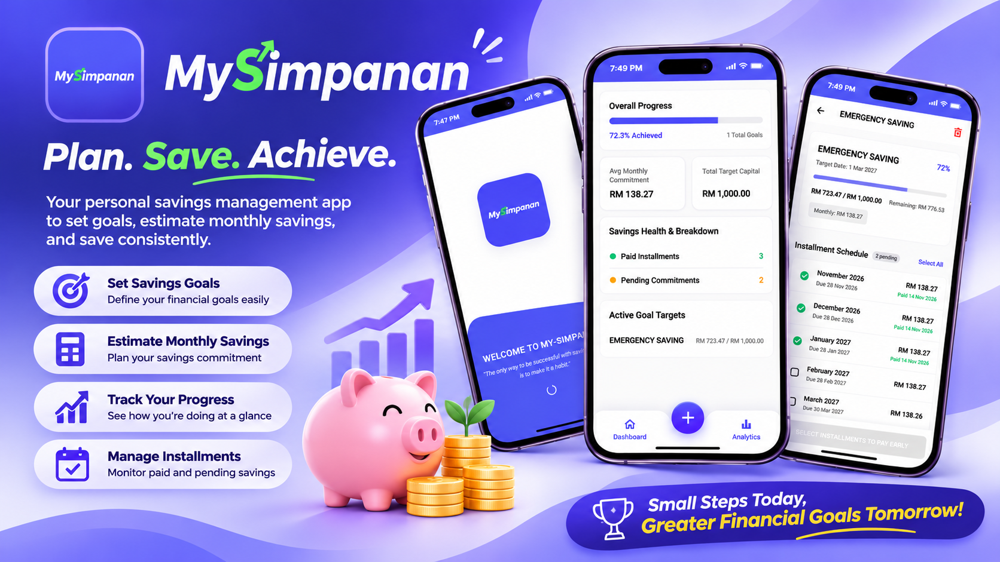

<div align="center">

# MySimpanan

[](https://github.com/Chesster06/my-simpanan)
[](https://flutter.dev/)
[](https://dart.dev/)
[](https://github.com/Chesster06/my-simpanan)
[](LICENSE)

**MySimpanan** is a disciplined personal savings goal tracker built with Flutter. Designed for structured wealth accumulation with automated monthly installment schedules, penny-exact remainder distribution, Pay Early advance checklists, offline persistence, and smart scheduled reminders.



</div>

---

## Key Features

- **Goal-Oriented Savings Tracking**: Create, view, and organize custom financial goals such as ASNB, emergency funds, and milestone investments.
- **Precision Installment Math**: Automatically divides targets across 1 to 120 months with exact cent/penny balancing across scheduled periods.
- **Flexible Pay Early Checklist**: Mark upcoming installments ahead of schedule or pay individual months in advance with real-time progress calculations.
- **Offline-First Persistence**: Local repository layer guarantees full functionality without requiring an active internet connection.
- **Smart Notification Reminders**: Native notification triggers with configurable lead times and daily schedule preferences.
- **Multilingual Support**: Built-in support for English and Bahasa Melayu locales.
- **Automated CI/CD Builds**: GitHub Actions workflows for continuous test verification, release Android APK packaging, and unsigned iOS IPA generation.

---

## Technology Stack

| Layer | Technologies |
| --- | --- |
| **Framework** | [Flutter 3.47.9](https://flutter.dev/) (Channel stable) |
| **Language** | [Dart](https://dart.dev/) |
| **State Management** | [Provider](https://pub.dev/packages/provider) |
| **Local Storage** | [shared_preferences](https://pub.dev/packages/shared_preferences) |
| **Notifications** | [flutter_local_notifications](https://pub.dev/packages/flutter_local_notifications) |
| **Design System** | Custom Minimalist Design System, Google Fonts (Plus Jakarta Sans) |
| **CI/CD Pipeline** | GitHub Actions (Android Release APK & iOS IPA) |

---

## Getting Started

### Prerequisites

- **Flutter SDK**: `3.47.9` or higher
- **Dart SDK**: bundled with Flutter
- **Git**
- Optional: Android Studio (for local Android builds) or Xcode (for macOS/iOS builds)

---

### Installation & Execution

#### 1. Clone the Repository

```bash
git clone https://github.com/Chesster06/my-simpanan.git
cd my-simpanan
```

#### 2. Install Dependencies

```bash
flutter pub get
```

#### 3. Run Static Analysis & Tests

```bash
flutter analyze
flutter test
```

#### 4. Launch Application

```bash
# Web browser
flutter run -d chrome

# Android or iOS connected device / emulator
flutter run
```

---

## Automated Builds (APK & IPA)

This repository includes pre-configured GitHub Actions workflows for continuous delivery:

- **Android APK**: Builds a release-signed APK on every push to `main` via [.github/workflows/build-apk.yml](.github/workflows/build-apk.yml).
- **iOS IPA**: Generates an unsigned IPA ready for AltStore, TrollStore, or Sideloadly via [.github/workflows/build-ipa.yml](.github/workflows/build-ipa.yml).

To download the compiled builds:
1. Navigate to the **[Actions](https://github.com/Chesster06/my-simpanan/actions)** tab on GitHub.
2. Select the latest successful run.
3. Download the zipped artifact under the **Artifacts** section at the bottom.

---

## Project Structure

```text
my-simpanan/
├── .github/
│   └── workflows/
│       ├── build-apk.yml               # Automated Android APK release pipeline
│       └── build-ipa.yml               # Automated iOS IPA build pipeline
├── assets/
│   ├── icons/
│   │   └── logo.png                    # Brand emblem & launcher icon source
│   └── images/
│       ├── MySimpananBanner.png        # Repository showcase banner
│       └── savings_empty_state.png     # Clean 3D vector illustration for empty states
├── lib/
│   ├── models/                         # Domain models (SavingsGoal, InstallmentItem)
│   ├── providers/                      # Business state management (SavingsProvider)
│   ├── repositories/                   # Data access and local storage persistence
│   ├── screens/                        # Feature views (Dashboard, CreateGoal, Detail, Settings)
│   ├── services/                       # Computation logic (InstallmentCalculator, Notifications)
│   ├── theme/                          # Colors, themes, and design tokens
│   ├── widgets/                        # Reusable modular UI components
│   └── main.dart                       # App initialization and entrypoint
├── test/                               # Comprehensive unit, widget, and E2E test suites
├── pubspec.yaml                        # Project metadata, assets, and dependencies
└── README.md                           # Documentation and guides
```

---

## Author

- **Developer**: [Chesster (Chesster06)](https://github.com/Chesster06)
